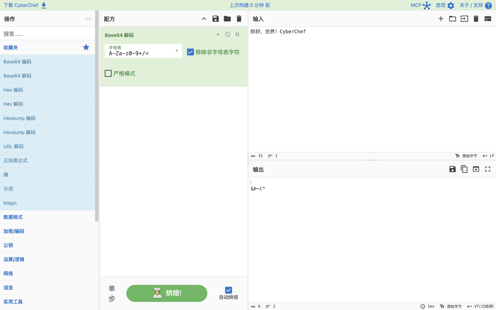
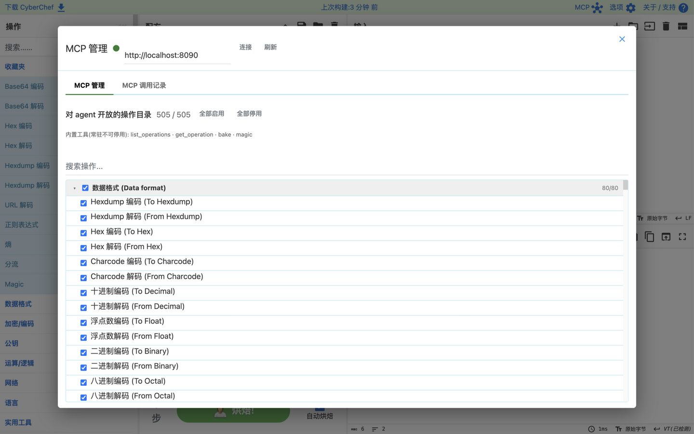
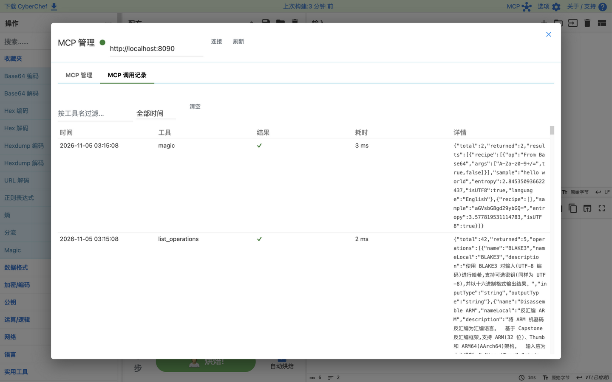
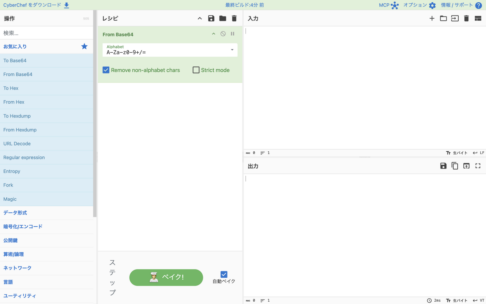

<p align="center">
  
</p>

# CyberChef 汉化增强版 · CyberChef i18n & MCP Edition

[](LICENSE)
[](https://github.com/gchq/CyberChef)


> **网络瑞士军刀的中文增强发行版**:完整简中本地化 + 多语言界面 + 内置 MCP 服务,供 AI agent 调用 505 个操作。
> A community **fork of [GCHQ CyberChef](https://github.com/gchq/CyberChef)** (v11.5.0) featuring **full Simplified Chinese localization**, a **multilingual UI** (8 languages) and a **built-in [MCP](https://modelcontextprotocol.io) server** that exposes all 505 operations to AI agents.

**简体中文 | [English](#english)**

---

## Fork 说明(必读)

本仓库是 [GCHQ CyberChef](https://github.com/gchq/CyberChef) 的增强 fork:

- **基线**:上游 `v11.5.0`(commit `8cd426dd`),核心运算代码、全部操作与 Apache-2.0 许可证完整保留,版权归原作者所有
- **本仓库的修改**:① 简体中文完整本地化 ② MCP 服务(`src/mcp/`)③ 多语言框架(`src/web/i18n/`)④ 一体化 Docker 部署套件(`cyberchef/cyberchef-service/`)。差异清单见下文[与上游的主要差异](#与上游的主要差异)
- **建议以 GitHub Fork 方式创建本仓库**(保留 fork 网络与星标归属);若作为独立仓库上传,请保留本节与许可证声明
- **同步上游**:

```bash
git remote add upstream https://github.com/gchq/CyberChef.git
git fetch upstream && git merge upstream/master   # 冲突集中在 src/web 与本仓库改动文件
```

## 功能特性

1. **完整简体中文本地化** —— 界面、505 个操作的名称/描述/参数/选项、分类、帮助气泡全量翻译;操作标识(配方/收藏/URL)保留英文以确保兼容
2. **MCP 服务内置** —— 为 AI agent 提供 `list_operations` / `get_operation` / `bake` / `magic` 四个常驻工具;Web 界面「MCP」管理面板可按分类勾选对 agent 开放的操作目录(三态树状勾选),双 sheet 查看调用记录(工具名搜索 + 时间范围筛选);支持 stdio 与 Streamable HTTP 两种接入
3. **多语言界面** —— 简体中文之外新增繁体中文、日语、韩语、德语、法语、西班牙语,词典按语言分包按需加载,缺键自动回退英文
4. **一体化离线部署** —— Web + MCP 单容器镜像(nginx + Node),ARM64 离线包解压即用

Web 端全部运算仍在浏览器本地完成;MCP 在服务端以 Node 运行时执行操作。内网/离线环境友好,不依赖任何外部服务。

## 界面预览 · Screenshots

| 中文主界面(505 操作全量汉化) | MCP 管理面板(分类三态勾选) |
| :---: | :---: |
|  |  |

| MCP 调用记录(工具/时间筛选) | 多语言界面(日本語) |
| :---: | :---: |
|  |  |

## 语言支持

| 语言 | 界面文案 | 分类 | 操作目录(名称/描述/参数) |
| --- | --- | --- | --- |
| 简体中文 zh-CN | ✅ 全量 | ✅ | ✅ 全量(505 操作) |
| 繁体中文 zh-TW | ✅ 全量 | ✅ | ✅ 名称全量,描述/参数回退英文 |
| 日本語 ja / 한국어 ko / Deutsch / Français / Español | ✅ 全量 | ✅ | ➖ 回退英文(可增量补充) |
| English | ✅(源语言) | ✅ | ✅(源语言) |

词典位于 `src/web/i18n/languages/<code>/`(ui/categories/operations/descriptions/args/options 六类 JSON + patterns)。补充翻译时直接在对应语言目录添加词条即可,缺失键回退英文;`node src/web/i18n/extract.mjs` 可从源码导出待译清单。新增语言:建目录 + 词典 + 在 `i18n.mjs` 的 `LANGUAGES` 注册 + `index.html` 语言下拉加选项。

## 快速开始

```bash
npm install
npm start          # 开发服务器 http://localhost:8080
npm test           # 全量测试(含 i18n 与 MCP 测试)
npm run build      # 生产构建(语言词典自动分包)
```

本地 MCP 调试(stdio,可直接配置进 agent):

```bash
npm run mcp
```

## 离线部署(单容器一体化,ARM64)

Web + MCP 同容器(`:8080` 界面,`:8090` MCP),面向内网服务器离线部署:

```bash
bash cyberchef/cyberchef-service/build-arm64.sh   # Mac 上构建并导出镜像
# 传到服务器后:
cd cyberchef/cyberchef-service && bash deploy.sh start   # 一键启动
```

详见 [cyberchef/cyberchef-service/README.md](cyberchef/cyberchef-service/README.md)。

## MCP 工具

| 工具 | 用途 |
| --- | --- |
| `list_operations` | 搜索操作目录(多语言,按名称/描述/分类过滤) |
| `get_operation` | 查看操作的完整参数 schema(类型/默认值/枚举) |
| `bake` | 执行配方链,输出 string/hex/base64/byteArray |
| `magic` | 自动探测编码/加密,返回可直接回填 bake 的候选配方 |

工具支持 `lang` 参数返回对应语言的名称与描述。被管理面板停用的操作对所有工具隐藏。安全边界:输入 ≤10MB、配方 ≤50 步、输出截断 256KB、单次调用 30s 超时;MCP 无认证,仅限可信内网。

## 与上游的主要差异

- `src/web/i18n/`:多语言层(词典 + 运行时翻译 + 词典提取工具)
- `src/mcp/`:MCP 服务(工具层/状态/协议/容器入口)
- `src/web/` 若干 waiter/UI:语言切换、MCP 管理面板(选项左侧「MCP」按钮,全屏双 sheet)
- `src/node/api.mjs`:参数合法值校验(大小写不敏感、归一化)
- `cyberchef/cyberchef-service/`:一体化 Docker 部署套件(compose/deploy/镜像构建)

## Keywords · 搜索关键词

<!-- 供 GitHub / 搜索引擎检索命中,中英双语 -->

`CyberChef 中文版` · `CyberChef 汉化` · `CyberChef 中文` · `网络瑞士军刀` · `在线加解密` · `编码解码工具` · `Base64 解码` · `CyberChef MCP` · `MCP Server` · `Model Context Protocol` · `AI agent tools` · `CyberChef localization` · `CyberChef i18n` · `CyberChef l10n` · `multilingual CyberChef` · `CyberChef 中文本地化` · `繁體中文` · `日本語` · `한국어` · `cybersecurity tools` · `encode / decode / encrypt / decrypt online` · `offline airgapped`

## 推荐 GitHub 仓库设置

**About 一句话描述(可直接粘贴)**:

```
CyberChef 中文增强版:完整简中本地化 + 8 语言界面 + 内置 MCP 服务(AI agent 可调用全部 505 操作)| Fork of GCHQ CyberChef with zh-CN localization, multilingual UI and a built-in MCP server
```

**Topics(仓库页 About → 齿轮 → topics,直接粘贴空格分隔)**:

```
cyberchef mcp mcp-server model-context-protocol ai-tools ai-agent i18n l10n localization multilingual chinese zh-cn zh-tw japanese korean german french spanish cybersecurity encode decode encryption swiss-army-knife offline
```

**Homepage**:可留空,或指向你的在线部署地址。

## English

A fork of [GCHQ CyberChef](https://github.com/gchq/CyberChef) (based on v11.5.0, Apache-2.0) that adds:

- **Full Simplified Chinese localization** — the entire UI plus all 505 operations (names, descriptions, arguments, option labels) are translated, while English operation identifiers stay intact for recipe/URL compatibility.
- **Built-in MCP server** — four always-on tools (`list_operations`, `get_operation`, `bake`, `magic`) expose the operation catalog to AI agents over stdio or Streamable HTTP. A full-screen management panel in the web UI controls which operations agents may use (tri-state category checkboxes) and shows a searchable, time-filtered call log.
- **Multilingual UI** — 简体中文, 繁體中文, 日本語, 한국어, Deutsch, Français, Español and English; per-language dictionary chunks load on demand and any missing key falls back to English.
- **All-in-one offline deployment** — a single nginx+Node container (ARM64) serves both the web app (`:8080`) and MCP (`:8090`); the offline bundle starts with one command.

```bash
npm install && npm start     # dev server
npm run mcp                  # local MCP server (stdio)
```

All credit for the original CyberChef goes to [GCHQ](https://github.com/gchq); this repository only adds the features above under the same Apache-2.0 license.

## 联系方式 · Contact

<div align="center">

**邮箱 / Email**: [1477746214@qq.com](mailto:1477746214@qq.com)

**微信扫码交流 / Scan to chat on WeChat**


</div>

## 许可与致谢

本项目基于 GCHQ 的 [CyberChef](https://github.com/gchq/CyberChef) 修改,遵循其 [Apache License 2.0](LICENSE)。
感谢上游团队的卓越工作。
